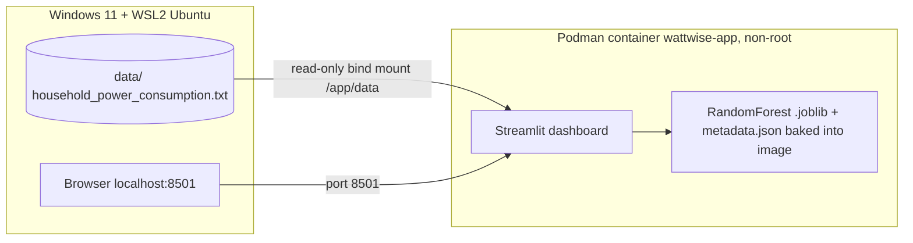

# ⚡ WattWise — Electricity Usage Pattern Classifier
*Household Energy Intelligence* — a Streamlit dashboard that classifies household electricity readings with a Random Forest and replays historical smart-meter data, **running in a rootless Podman container on Ubuntu/WSL2**.

## Course relevance (Linux and Container Technologies)
Demonstrates image build, container lifecycle (run/stop/start/logs/inspect), rootless non-root execution, port publishing (host ↔ container), and read-only bind-mounted volumes, using a single `Containerfile`.

## Technologies
Python 3, Streamlit, scikit-learn (RandomForestClassifier), Pandas/NumPy, Plotly, Joblib, Podman.

## Dataset
UCI *Individual Household Electric Power Consumption* — file `household_power_consumption.txt` (semicolon-delimited, `?` = missing). 2,049,280 valid readings of 2,075,259 minutes (2006-12-16 → 2010-11-26), 25,979 missing/absent minutes (excluded, never interpolated). One-minute sampling; power in kW (average over the minute).

## Classification methodology (pseudo-labels)
The dataset has **no ground-truth labels**. Labels are deterministic rules whose thresholds come from the **training period only** (first 80 % of valid readings chronologically; train 2006-12-16 → 2010-02-05, test 2010-02-05 → 2010-11-26):

| Class | Rule | Threshold |
|---|---|---|
| Unusually High | active power > training 95th percentile | 3.388 kW |
| Standby-like | power ≤ training 15th percentile **and** 15-min rolling std ≤ training median | 0.240 kW, 0.0621 kW |
| Normal | everything else | — |

Features: Global_active_power, Global_reactive_power, Voltage, Global_intensity, hour, day_of_week, is_weekend, roll_mean_15, roll_std_15 (rolling features use current and past readings only).
RandomForest: 100 trees, max_depth 12, random_state 42.

**Results (chronological holdout, 409,844 rows):** accuracy 1.0000, macro F1 1.0000.
**Read this carefully:** these measure agreement with the pseudo-labels, not real-world correctness. The labels are computed from power and rolling-std features that the model also receives (target leakage by construction), so the forest is learning a proxy for the rules and near-perfect scores are expected. This is not a validated anomaly detector, and "Standby-like" means *low, stable load*, not an identified appliance.

## Architecture

The model and metadata are baked into the image (no retraining on start). The dataset is **not** in the image; it is mounted read-only at `/app/data`. On first page load the app parses it once (~8 s) and caches it in memory; each replay day is predicted on demand.

## Quick start for anyone who clones this repo
```bash
cd data && unzip individual+household+electric+power+consumption.zip && cd ..   # or: python3 -c "import zipfile;zipfile.ZipFile('data/individual+household+electric+power+consumption.zip').extractall('data')"
podman build -t wattwise .
podman run -d --name wattwise-app -p 8501:8501 -v "$(pwd)/data:/app/data:ro" wattwise
```
Open http://localhost:8501. Only Podman (or Docker) is needed; the trained model is already in `model/artifacts/`. Run Podman as a normal user (see the rootless section below).

## Prerequisites
Windows 11, WSL2 Ubuntu, Podman (`podman --version`), and Python 3 only if you retrain locally. Dataset ZIP extracted into `data/` (already done).

## Train the model (optional — artifacts are already in `model/artifacts/`)
```bash
python3 -m venv .venv && .venv/bin/pip install -r requirements.txt pytest
.venv/bin/python model/train.py          # ~90 s; writes model/artifacts/*
.venv/bin/python -m pytest -q tests
```
Retrain with the same library versions as `requirements.txt` before rebuilding the image.

## Rootless Podman on WSL2 (required for Windows `localhost`)
Run Podman as a **normal user, not root**. Root Podman publishes ports with firewall NAT and no listening socket, so WSL2 does not forward Windows `localhost:8501` to it. Rootless Podman opens a real listener, which WSL forwards. One-time setup (as root):
```bash
useradd -m -s /bin/bash wattuser            # gets subuid/subgid ranges automatically
setcap cap_setuid=ep /usr/bin/newuidmap && setcap cap_setgid=ep /usr/bin/newgidmap   # needed on this Arch WSL
loginctl enable-linger wattuser             # keeps its containers alive after the shell closes
```
Then use the commands below as that user, for example `su - wattuser` then `cd` to the project (or `runuser -u wattuser -- env XDG_RUNTIME_DIR=/run/user/1000 podman ...`). The `Containerfile` binds Streamlit to `::` (dual-stack IPv4 + IPv6) because Windows resolves `localhost` to `::1` first.

## Build and run (verified commands)
```bash
podman build -t wattwise .
podman run -d --name wattwise-app -p 8501:8501 -v "$(pwd)/data:/app/data:ro" wattwise
```
Open **http://localhost:8501** in the Windows browser. The first load takes ~10 s while the dataset is read.

## Podman management
```bash
podman images; podman ps; podman ps -a
podman logs wattwise-app
podman inspect wattwise-app
podman stop wattwise-app; podman start wattwise-app
podman rm -f wattwise-app            # remove, then re-run to recreate
```

## Demo script (5–10 min)
1. `podman build`, `podman run`, then `podman ps` / `podman images`; show `podman exec wattwise-app ls -la /app/data` and that writing there fails (read-only).
2. Open localhost:8501 → press **Load Demo Day** (2010-11-22) → set speed 20x → **Start**.
3. Watch power, classification, kWh and High-usage % update; markers colour by class.
4. Pause/Reset; try "Show full day immediately".
5. Open **Model Information**: thresholds, metrics, confusion matrix, feature importance, and the pseudo-label caveat.
6. `podman logs wattwise-app`, `podman stop`, `podman start`; refresh — the app works again with no retraining.

## Known limitations
- Metrics measure agreement with rule-based pseudo-labels (leakage by design); no real-world validation.
- Replay is historical visualization, not live IoT. 1x = 5 min of data/second.
- Missing minutes are excluded from classification and energy (reported in the KPI note).
- Image is ~850 MB (scikit-learn/pandas/streamlit stack); the first page load parses the dataset once per container start.
- Dates without readings are rejected with a message. Demo day is picked from model predictions on the test period.
